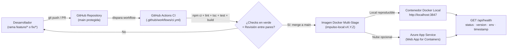

# Guía Operativa DevOps e Integración Continua — ImpulsoLocal

> **Asignatura:** IS-505 Modelado Ágil de Software — Práctica DevOps  
> **Proyecto:** Proyecto 6 · `ImpulsoLocal` (`josthin45/impulso-local`)  
> **Docente:** Gómez Calderón Israel Julio  
> **Equipo Kanban–XP:** Josthin Stalin Garcia Choez, Andres Gabriel Calucho Quijano, Mateo Issac Gonzales Reina  
> **Stack:** Next.js 15 (`output: "standalone"`), React 19, TypeScript 5, Vitest 3, ESLint 9, Docker, GitHub Actions

---

## 1. Objetivo de la práctica

Aplicar prácticas de **Integración Continua (XP)** y **calidad operativa (DevOps)** sobre `ImpulsoLocal` para garantizar que cada cambio integrado en `main`:

1. Se construya en un entorno reproducible sin depender de configuraciones manuales locales.
2. Ejecute verificaciones automáticas de estilo, tipos, reglas de negocio y compilación de producción antes de integrarse.
3. Proteja cualquier credencial o token operativo evitando su exposición en código, respuestas HTTP o registros (logs).
4. Permita comprobar el estado del servicio desplegado (`/api/health`), su versión activa, sus registros estructurados y un procedimiento claro de **rollback** ante fallos.

---

## 2. Arquitectura mínima de despliegue

La aplicación se empaqueta mediante un **`Dockerfile` multi-stage** basado en `node:20-alpine` usando el modo `standalone` de Next.js 15. Esto produce una imagen liviana y determinista que corre exactamente igual en un equipo local con Docker o en **Azure App Service (Web App for Containers)**.



### Etapas del `Dockerfile` multi-stage

| Etapa | Base | Propósito | Resultado |
| :--- | :--- | :--- | :--- |
| `deps` | `node:20-alpine` | Copia `package.json` y `package-lock.json` y ejecuta `npm ci` | Dependencias reproducibles aisladas |
| `builder` | `node:20-alpine` | Recibe `APP_VERSION` y `NEXT_PUBLIC_APP_ENV`, ejecuta `npm run build` | Artefacto `.next/standalone` y estáticos |
| `runner` | `node:20-alpine` | Ejecuta como usuario no-root (`nextjs:nodejs`), expone puerto `3847` y define `HEALTHCHECK` contra `/api/health` | Imagen final mínima sin devDependencies |

### Variables de entorno (`.env.example`)

| Variable | Ejemplo seguro | Uso operativo | ¿Sensible? |
| :--- | :--- | :--- | :--- |
| `PORT` | `3847` | Puerto HTTP del servidor Next.js | No |
| `NEXT_PUBLIC_APP_ENV` | `local` / `ci` / `production` | Identifica el entorno en `/api/health` | No |
| `APP_VERSION` | `0.1.0` | Versión desplegada reportada por `/api/health` | No |
| `HEALTHCHECK_TOKEN` | *(vacío en demo)* | Token opcional para `/api/health?check=strict` vía cabecera `x-healthcheck-token` | **Sí** (solo en `.env.local` o Secrets) |

---

## 3. Pipeline de Integración Continua (`.github/workflows/ci.yml`)

El pipeline se ejecuta automáticamente en cada `push` y en cada `pull_request` dirigido a `main`, con permisos mínimos (`contents: read`) y control de concurrencia (`cancel-in-progress: true`).

| Orden | Paso en GitHub Actions | Comando / Acción | Qué comprueba |
| :---: | :--- | :--- | :--- |
| 1 | Checkout del repositorio | `actions/checkout@v4` | Obtiene el commit exacto del PR o push |
| 2 | Configurar Node.js 20 con caché de npm | `actions/setup-node@v4` (`cache: npm`) | Garantiza runtime Node 20 LTS y caché indexado por `package-lock.json` |
| 3 | Instalar dependencias reproducibles | `npm ci` | Instala exactamente las versiones bloqueadas en `package-lock.json` |
| 4 | Verificar lint | `npm run lint` | Cumplimiento de reglas ESLint (`next/core-web-vitals`, `next/typescript`) |
| 5 | Verificar tipos de TypeScript | `npx tsc --noEmit` | Integridad de tipos en dominio, componentes y rutas API |
| 6 | Ejecutar pruebas automatizadas | `npm test` (`vitest run`) | Reglas de negocio, tablero Kanban, trazabilidad de historias y `/api/health` |
| 7 | Construir aplicación de producción | `npm run build` | Compilación completa de Next.js 15 (`standalone`) sin errores |

### Manejo seguro de variables y secretos en CI

En `.github/workflows/ci.yml` las variables de entorno se inyectan mediante el contexto `secrets` de GitHub Actions con respaldos seguros para entorno CI/demo:

```yaml
env:
  NEXT_PUBLIC_APP_ENV: ${{ secrets.NEXT_PUBLIC_APP_ENV || 'ci' }}
  APP_VERSION: ${{ secrets.APP_VERSION || '0.1.0-ci' }}
  HEALTHCHECK_TOKEN: ${{ secrets.HEALTHCHECK_TOKEN || '' }}
  NEXT_TELEMETRY_DISABLED: "1"
```

- Ningún paso ejecuta `echo` ni imprime variables sensibles en la consola de Actions.
- Si `HEALTHCHECK_TOKEN` se configura en *Settings → Secrets and variables → Actions*, GitHub lo enmascara automáticamente y las pruebas unitarias verifican que nunca aparezca ni en el cuerpo JSON ni en los logs estructurados.

---

## 4. Estrategia de ramas y revisión entre pares

1. **`main` protegida y estable:** no se hace push directo a `main`; todo cambio ingresa mediante Pull Request con el workflow `CI - ImpulsoLocal` en verde.
2. **Ramas de trabajo cortas:**
   - `feature/<tema>` para nuevas historias o mejoras (ej. `feature/practica-devops`).
   - `fix/<defecto>` para correcciones puntuales (ej. `fix/validacion-cupos`).
3. **Revisión entre pares (XP):** antes de aprobar un PR, un integrante distinto al autor valida:
   - Que el PR enlace explícitamente la historia (`IL-XX`), el criterio de aceptación y la prueba que lo respalda.
   - Que no existan secretos, archivos `.env` ni datos personales reales.
   - Que la suite de pruebas y el build pasen en GitHub Actions.

---

## 5. Guía paso a paso: evidencia de prueba fallida controlada y corrección en GitHub Actions

Para documentar en el informe PDF cómo el pipeline CI detiene un cambio defectuoso antes de llegar a `main`, sigue exactamente estos pasos cuando decidas hacer push:

### Paso 1: Subir la rama y abrir el Pull Request inicial (run verde)

```bash
git push -u origin ElRascuacho/practica-devops
```

Abre un Pull Request hacia `main` en GitHub y verifica que el primer run de **CI - ImpulsoLocal** termine en verde (`✓`).

### Paso 2: Provocar un fallo controlado en una prueba trazable

Edita temporalmente `domain/traceability.test.ts` en el caso de **IL-05** (o `app/api/health/route.test.ts` cambiando el status esperado de `200` a `500`), por ejemplo:

- En `app/api/health/route.test.ts`, cambia temporalmente:
  ```ts
  expect(res.status).toBe(200);
  ```
  por:
  ```ts
  expect(res.status).toBe(500); // Fallo controlado para evidencia CI
  ```
- Comprueba localmente con `bun run test` que la prueba falla exactamente en esa aserción.
- Crea un commit descriptivo y súbelo a la misma rama del PR:
  ```bash
  git add app/api/health/route.test.ts
  git commit -m "test(ci): introduce controlled failure to verify CI gate"
  git push
  ```

### Paso 3: Capturar la evidencia del run fallido en GitHub Actions

1. Abre la pestaña **Actions** del repositorio (o la sección *Checks* del PR).
2. Entra al run fallido (`✗`) en el paso **Ejecutar pruebas automatizadas (Vitest)**.
3. Toma captura mostrando:
   - El estado rojo del check en el PR (bloqueando el merge).
   - El detalle de la aserción fallida en Vitest (`expected 200 to be 500`).
   - Que el paso posterior **Construir aplicación de producción** fue omitido automáticamente.

### Paso 4: Corregir la prueba, volver a subir y capturar el run exitoso

1. Revierte el cambio temporal (o restaura `expect(res.status).toBe(200);`).
2. Verifica localmente: `bun run test && bun run build`.
3. Crea el commit de corrección y súbelo:
   ```bash
   git add app/api/health/route.test.ts
   git commit -m "test(ci): restore expected 200 status in /api/health test"
   git push
   ```
4. Captura el nuevo run en verde (`✓`) en GitHub Actions y el PR listo para revisión entre pares y merge.

---

## 6. Verificación operativa, registros (logs) y procedimiento de rollback

### 6.1 Recorrido principal y versión desplegada

1. **Verificación de salud y versión (`GET /api/health`):**
   ```bash
   curl -i http://localhost:3847/api/health
   ```
   Respuesta esperada (`200 OK`, `Cache-Control: no-store`):
   ```json
   {
     "status": "ok",
     "service": "impulso-local",
     "version": "0.1.0",
     "environment": "local",
     "timestamp": "2026-11-26T18:00:00.000Z",
     "checks": {
       "app": "ok",
       "tokenConfigured": false
     }
   }
   ```
2. **Recorrido funcional de negocio en la UI (`http://localhost:3847`):**
   - Voluntaria Camila Ortiz revisa recomendación (sin inscripción automática) y se postula.
   - Organizadora Mariana Vélez confirma sin exceder cupos (`IL-05`), inicia actividad y valida cierre tras evidencia (`IL-07`).
   - Tablero `/tablero` respeta límites WIP (`IL-11`).

### 6.2 Casos de error controlados

| Caso | Petición | Código HTTP | Código JSON | Comportamiento de seguridad |
| :--- | :--- | :---: | :--- | :--- |
| Parámetro `check` inválido | `GET /api/health?check=invalido` | `400` | `INVALID_CHECK_PARAM` | Registra `warn` estructurado sin filtrar secretos |
| Token inválido en modo `strict` | `GET /api/health?check=strict` (con `HEALTHCHECK_TOKEN` definido) | `401` | `UNAUTHORIZED_HEALTHCHECK` | Solo registra `tokenProvided: true/false`, nunca el token |
| Método HTTP no permitido | `POST /api/health` | `405` | `METHOD_NOT_ALLOWED` | Incluye cabecera `Allow: GET` y log `warn` |

### 6.3 Registros estructurados (logs)

Cada llamada a `/api/health` emite un registro JSON en una sola línea hacia `stdout`/`stderr` (compatible con `docker logs` y Azure Log Stream):

```json
{"level":"info","service":"impulso-local","event":"healthcheck.ok","timestamp":"2026-11-26T18:00:00.000Z","statusCode":200,"check":"basic","environment":"local","version":"0.1.0"}
{"level":"warn","service":"impulso-local","event":"healthcheck.invalid_parameter","timestamp":"2026-11-26T18:00:05.000Z","statusCode":400,"check":"invalido","environment":"local"}
```

En contenedor local se consultan con:

```bash
docker logs --tail 50 <container_id>
```

### 6.4 Procedimiento de rollback a versión estable

Si un despliegue presenta una regresión en producción o falla el healthcheck:

1. **Rollback a nivel de código en Git (recomendado en `main`):**
   ```bash
   # Identificar el último commit o tag estable (ej. v0.1.0)
   git log --oneline -n 5
   git tag -l

   # Crear commit de reversión sin reescribir historial compartido
   git revert <commit_defectuoso>
   ```
   El commit de `revert` pasa por el mismo pipeline de CI y restaura `main` de forma auditable.
2. **Etiquetado de versiones estables:**
   ```bash
   git tag -a v0.1.0 -m "Release estable ImpulsoLocal v0.1.0"
   ```
3. **Rollback inmediato de contenedor (Docker / Azure App Service):**
   - Detener el contenedor fallido (`impulso-local:0.2.0`) y levantar la imagen previa etiquetada (`impulso-local:0.1.0`):
     ```bash
     docker run --rm -p 3847:3847 -e APP_VERSION=0.1.0 -e NEXT_PUBLIC_APP_ENV=production impulso-local:0.1.0
     ```
   - En Azure App Service: cambiar el tag de imagen en *Deployment Center* (o *Deployment Slots → Swap*) hacia `v0.1.0` y confirmar en `GET /api/health` que `"version": "0.1.0"` y `"status": "ok"`.

---

## 7. Tratamiento de secretos y privacidad

- **Plantilla versionada sin valores sensibles:** únicamente `.env.example` forma parte del repositorio; `.gitignore` bloquea `.env*` excepto `!.env.example`.
- **Cero secretos en el cliente ni en logs:** `HEALTHCHECK_TOKEN` solo se lee del lado servidor (`app/api/health/route.ts`), nunca se expone con prefijo `NEXT_PUBLIC_` y nunca se imprime en respuestas ni en `console.*`.
- **Datos ficticios:** las identidades del dominio (`domain/seed.ts`) son completamente ficticias; no se almacenan datos personales reales.

---

## 8. Matriz de trazabilidad (Historia → Criterio → Prueba → Evidencia)

| Historia | Descripción | Criterio de aceptación principal | Prueba automatizada | Ruta / Evidencia |
| :--- | :--- | :--- | :--- | :--- |
| `IL-03` | Recomendar con reglas visibles y sin inscribir | La recomendación explica habilidades/intereses/horario y no crea postulación | `domain/rules.test.ts` (`recomendación`) | `/reglas` · `npm test` |
| `IL-04` | Postular y advertir si el horario no coincide | Postulación queda pendiente y advierte sin bloquear el envío | `domain/rules.test.ts` (`postulación, cupos y horario`) | `/retos/rt-lectura` |
| `IL-05` | Confirmar a mano sin pasar el cupo | Solo el organizador confirma; si cupos llenos, rechaza la siguiente confirmación | `domain/rules.test.ts` y `domain/traceability.test.ts` (`IL-05`) | PR con CI + `/retos/rt-lectura` |
| `IL-07` | Reservar validación de cierre al organizador | Voluntarios y otros organizadores no pueden validar el cierre | `domain/rules.test.ts` y `domain/traceability.test.ts` (`IL-07`) | PR con CI + `/retos/rt-lectura` |
| `IL-11` | Probar reglas, permisos, transiciones y WIP | Suite cubre reglas de dominio y rechazo de WIP lleno en tablero Kanban | `domain/kanban.test.ts` y `domain/traceability.test.ts` (`IL-11`) | `npm test` · `.github/workflows/ci.yml` |
| `OPS-01` | Verificación operativa y CI reproducible | `/api/health` reporta `ok`, versión, entorno y timestamp sin filtrar secretos y maneja errores `400`/`401`/`405` | `app/api/health/route.test.ts` | `/api/health` · `Dockerfile` · CI |
